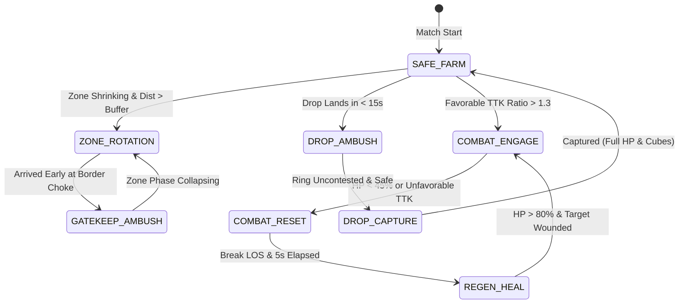

# Mech Royale Tactical Systems Specification & Multi-Agent Blueprint

This document specifies the modular architecture for the Mech Royale (`mechfight/1`) bot. Each tactical dimension is designed as an independent module with clean interfaces, mathematical models, and adversarial failure analysis ("what could go wrong").

---

## Architecture Overview

```
                               ┌─────────────────────────┐
                               │     bot.py (Main FSM)   │
                               └────────────┬────────────┘
                                            │
        ┌───────────────────┬───────────────┴───────────────┬───────────────────┐
        ▼                   ▼                               ▼                   ▼
┌───────────────┐   ┌───────────────┐               ┌───────────────┐   ┌───────────────┐
│  rooftops.py  │   │  acoustics.py │               │  artillery.py │   │ gatekeeper.py │
│ (Verticality) │   │ (Sound Radar) │               │(Indirect Fire)│   │ (Zone Chokes) │
└───────┬───────┘   └───────┬───────┘               └───────┬───────┘   └───────┬───────┘
        │                   │                               │                   │
        └───────────────────┴───────────────┬───────────────┴───────────────────┘
                                            ▼
                                ┌─────────────────────────┐
                                │ nav.py / ballistics.py  │
                                └─────────────────────────┘
```

---

## Module 1: `rooftops.py` (Verticality & 3D Rooftop Control)

### Purpose
Identifies climbable building roofs, computes vertical jet energy requirements, executes roof climbs to break ground pursuits, and plans safe descents.

### Physics & Numbers
* Mech height: $9.0\text{ m}$. Jet acceleration: $34\text{ m/s}^2$ upward (capped at $10\text{ m/s}$ rise speed).
* Energy cap: 100. Jet drain: $15\text{ energy/s}$. Ground jump: $11\text{ m/s}$ upward.
* Energy required to climb height $H$:
  $t_{\text{rise}} \approx \frac{H - 1.2}{10.0} \implies E_{\text{jet}} \approx t_{\text{rise}} \times 15.0$.
  For a $15\text{ m}$ roof: $t_{\text{rise}} \approx 1.4\text{ s} \implies E \approx 21\text{ energy}$.
* **Zero fall damage**: Mechs can drop off any roof safely.

### Interface
```python
class RooftopManager:
    def __init__(self, world_prisms: List[Dict]): ...
    def find_nearest_climbable_roof(self, my_pos: Vec3, current_energy: float) -> Optional[RoofTarget]: ...
    def compute_climb_action(self, my_pos: Vec3, target_roof: RoofTarget) -> Dict[str, Any]: ...
    def should_descend(self, my_pos: Vec3, zone_info: Dict) -> bool: ...
```

### Adversarial Red-Team / What Could Go Wrong?
1. **Energy Starvation Fall**: If the bot begins a climb with $< 30$ energy, it stalls at 12m and falls to the ground with 0 energy, completely defenseless.
   * *Mitigation*: Only attempt climbs if `energy >= E_required + 30`.
2. **Overhang Trapping**: Roof edges with eaves $< 9.0\text{ m}$ above feet stop jets.
   * *Mitigation*: Approach roofs from open faces without overhang geometry.
3. **Mortar Exposure**: Open rooftops have zero overhead cover. A mortar splash ($7\text{ m}$ radius) easily hits a camped mech.
   * *Mitigation*: Never camp permanently on roofs; use roofs as a 10-second pursuit-breaker to trigger out-of-combat 45 HP/s healing, then drop down.

---

## Module 2: `acoustics.py` (Sound Triangulation & Conflict Heatmap)

### Purpose
Ingests `obs.sounds`, filters out Gaussian bearing noise ($\sigma = 7^\circ$), tracks conflict epicenters, and steers the bot away from deathballs and toward isolated weak targets.

### Physics & Numbers
* Detection ranges: Gun ($320\text{ m}$), Mortar/Explosion ($420\text{ m}$), Laser ($380\text{ m}$), Death ($600\text{ m}$).
* Reports: `bearing` (world yaw), `dist` (`near` $<60\text{ m}$, `mid` $<160\text{ m}$, `far`), `age`.

### Interface
```python
class AcousticRadar:
    def update(self, sounds: List[Dict], my_pos: Vec3, current_time: float): ...
    def get_conflict_heatmap(self) -> List[ConflictCluster]: ...
    def get_safest_rotation_heading(self, my_pos: Vec3, zone_center: Vec2) -> float: ...
    def find_isolated_survivor(self) -> Optional[Vec2]: ...
```

### Adversarial Red-Team / What Could Go Wrong?
1. **Phantom Triangulations**: Two independent bots firing in different directions can create conflicting bearings that appear as an erratic moving target.
   * *Mitigation*: Cluster sounds temporally ($< 1.0\text{ s}$) and spatially; do not track single sounds as confirmed units.
2. **Sound Decoy / Crate Farming**: A lone bot shooting a crate sounds identical to a gunfight.
   * *Mitigation*: Classify as "major battle" only if multiple distinct sound kinds (`gun` + `laser` + `death` or repeated bursts) occur in the cluster.
3. **Acoustic Stalemate**: If sounds are heard on multiple sides, the bot might freeze.
   * *Mitigation*: Always prioritize the safe zone vector; sound danger acts as a repulsive force, not a hard barrier.

---

## Module 3: `artillery.py` (Blind Mortar & Chokepoint Siege)

### Purpose
Calculates indirect ballistic trajectories ($g = 22\text{ m/s}^2$) to bombard targets over buildings without line of sight, specifically targeting stationary supply drop capturers and camped corners.

### Physics & Numbers
* Mortar speed: $72\text{ m/s}$. Gravity: $22\text{ m/s}^2$. Cooldown: $2.6\text{ s}$.
* Direct damage: 200. Splash: 160 ($7\text{ m}$ radius). Concussion: $16\text{ m/s}$ knockback, drains 45 energy.
* Range formula: $R = \frac{v^2}{g} \sin(2\theta) \implies \theta = 0.5 \arcsin\left(\frac{g R}{v^2}\right)$. Max range $\approx 235\text{ m}$.
* Self-damage: Own splash deals 50% damage and knocks self back.

### Interface
```python
class ArtillerySolver:
    def solve_trajectory(self, my_pos: Vec3, target_pos: Vec3) -> Optional[Tuple[float, float, float]]: ... # yaw, pitch, flight_time
    def can_clear_obstacles(self, my_pos: Vec3, target_pos: Vec3, theta: float) -> bool: ...
    def should_fire_indirect(self, target_type: str, target_dist: float, target_stationary: bool) -> bool: ...
```

### Adversarial Red-Team / What Could Go Wrong?
1. **Self-Explosion at Point Blank**: Firing at a target $< 15\text{ m}$ away or when standing directly facing a high wall causes the shell to hit the wall at $z+9.5$, splashing the bot for 80 damage and concussing itself!
   * *Mitigation*: Hard minimum range clamp: never fire mortar if target distance $< 25\text{ m}$ or if wall obstacle is within $4\text{ m}$ along launch pitch.
2. **Flight-Time Misses on Moving Targets**: At $150\text{ m}$, shell flight time is $\approx 3.5\text{ seconds}$. A walking mech moves $40\text{ m}$ in that time!
   * *Mitigation*: Only fire blind mortar at **stationary targets**:
     - Mechs capturing a supply drop ($4.0\text{ s}$ stationary ring freeze).
     - Known camper corners behind low walls.
3. **Laser Cookoff Exposure**: Holding a mortar invites $+60\%$ cookoff damage from enemies carrying a laser.
   * *Mitigation*: If an enemy with a laser is detected within $200\text{ m}$, swap active weapon slot or drop mortar.

---

## Module 4: `gatekeeper.py` (Zone Chokepoint & Rotation Engine)

### Purpose
Anticipates zone shrink timings, computes traversal times across terrain, identifies building bottlenecks, and positions the bot on the inside edge to eliminate late-rotating enemies.

### Physics & Numbers
* Phases: 560m $\to$ 380m $\to$ 240m $\to$ 140m $\to$ 70m $\to$ 25m $\to$ 0m.
* DPS: 20 $\to$ 35 $\to$ 60 $\to$ 100 $\to$ 160 $\to$ 260 HP/s.
* Zone damage resets the 5-second out-of-combat heal timer!

### Interface
```python
class ZoneGatekeeper:
    def evaluate_rotation_urgency(self, my_pos: Vec2, zone_obs: Dict, my_speed: float) -> Tuple[bool, float]: ... # needs_rotation, eta_seconds
    def find_chokepoints(self, current_radius: float, next_center: Vec2, next_radius: float) -> List[Vec2]: ...
    def select_gatekeep_position(self, my_pos: Vec2, chokepoint: Vec2) -> Vec2: ...
```

### Adversarial Red-Team / What Could Go Wrong?
1. **The Stadium Pinch**: The safe zone often shrinks across Ohio Stadium. The stadium's massive walls ($>200\text{ m}$ long) create dead ends. A bot rotating too late gets trapped against the curved concrete exterior as the 60+ DPS zone sweeps over it.
   * *Mitigation*: Precompute stadium bypass paths; initiate rotation when distance to border is within $1.5\times$ travel time.
2. **Reverse Gatekeep**: While waiting at a chokepoint to ambush incoming bots, another bot arrives from behind or a high roof.
   * *Mitigation*: Gatekeep positions must have rear cover and an immediate escape route into the safe zone.

---

## State Transition Diagram


